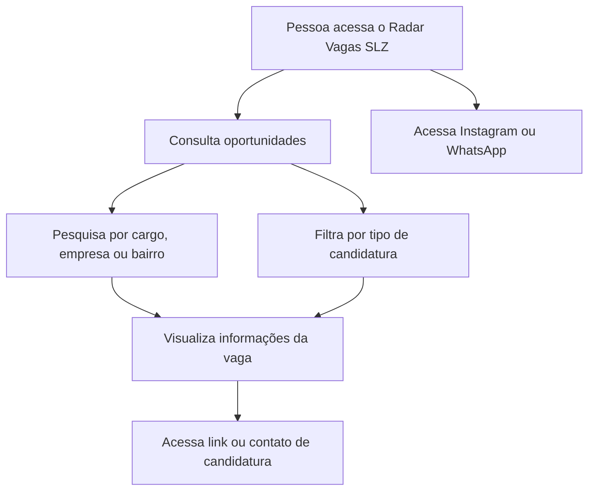

# 📡 Radar Vagas SLZ

### Oportunidades na Ilha do Amor

**Uma plataforma para facilitar a descoberta e o acesso a vagas de emprego em São Luís e região metropolitana do Maranhão.**

**[🚀 Ver demonstração online](https://job-spark-saoluiz.lovable.app/)**

---

## 📋 Sobre o projeto

O **Radar Vagas SLZ** é uma iniciativa digital voltada à divulgação e à consulta de oportunidades profissionais em **São Luís (MA) e região metropolitana**.

A plataforma reúne anúncios de vagas em uma interface de navegação simples, com mecanismos de pesquisa e filtros que ajudam as pessoas a encontrar oportunidades e acessar os canais de candidatura informados em cada anúncio.

O projeto complementa a presença do Radar Vagas SLZ nas redes sociais, oferecendo um ponto de consulta organizado para quem busca emprego e estágio.

> **Proposta:** aproximar pessoas de oportunidades de trabalho por meio de uma experiência digital acessível e organizada.

## 🖥️ Demonstração

A aplicação está disponível publicamente:

### **[job-spark-saoluiz.lovable.app](https://job-spark-saoluiz.lovable.app/)**

**Prévia da interface:**

<!-- Adicione uma captura real da aplicação em assets/screenshot-home.png para habilitar a imagem abaixo. -->
<!--  -->

## ✨ Funcionalidades observadas

- **Listagem de oportunidades:** consulta de anúncios de emprego publicados na plataforma.
- **Pesquisa de vagas:** campo de busca por cargo, empresa ou bairro.
- **Filtros de candidatura:** navegação entre todas as oportunidades, vagas com links e oportunidades com contato direto.
- **Informações da vaga:** visualização de cargo, empresa, localidade, data e descrição disponível no anúncio.
- **Acesso à candidatura:** direcionamento ao link ou ao contato indicado para a oportunidade.
- **Integração com a comunidade:** acesso aos canais do projeto no Instagram e no WhatsApp.

> As funcionalidades acima foram verificadas na interface pública. Recursos administrativos, integrações internas e regras de publicação não foram validados nesta documentação.

## 🎯 Objetivos

- Facilitar a descoberta de oportunidades profissionais na região.
- Centralizar anúncios em uma interface de consulta.
- Tornar mais simples o acesso aos canais de candidatura.
- Complementar a divulgação realizada nas redes sociais.
- Aplicar ferramentas digitais à solução de uma necessidade real da comunidade.

## 🧭 Como utilizar

1. Acesse **[Radar Vagas SLZ](https://job-spark-saoluiz.lovable.app/)**.
2. Consulte as oportunidades apresentadas na página inicial.
3. Utilize a pesquisa para localizar um cargo, empresa ou bairro de interesse.
4. Se desejar, selecione o filtro de tipo de candidatura.
5. Leia as informações da vaga e utilize o link ou contato informado no anúncio.

**Atenção:** requisitos, prazos e disponibilidade das oportunidades podem mudar. Antes de se candidatar, confira os dados no canal oficial da empresa contratante.

## 🛠️ Tecnologias e desenvolvimento

| Recurso | Utilização |
| --- | --- |
| **Lovable** | Plataforma utilizada para o desenvolvimento e a publicação da aplicação web. |
| **GitHub** | Documentação e apresentação do projeto no portfólio. |
| **Web** | Acesso à plataforma por navegador. |

**Stack técnica detalhada:** a confirmar após a conexão ou exportação do código-fonte do projeto. A documentação não atribui frameworks, bancos de dados ou serviços que ainda não foram verificados.

## 🏗️ Visão funcional

*O diagrama representa a jornada visível do usuário, não a arquitetura interna do código.*

## 📱 Canais do projeto

- **Plataforma:** https://job-spark-saoluiz.lovable.app/
- **Instagram:** https://www.instagram.com/radarvagasslz/
- **WhatsApp:** acesso ao grupo por meio do link disponibilizado na plataforma.

## 🔎 Qualidade das informações

O Radar Vagas SLZ funciona como um canal de divulgação e consulta de oportunidades. Os processos seletivos, critérios de contratação e decisões de recrutamento pertencem às empresas responsáveis pelas vagas.

Sempre que possível, a pessoa candidata deve conferir a autenticidade do anúncio, os requisitos e os prazos diretamente nos canais oficiais informados.

## 🚧 Evolução do projeto

Possibilidades de melhoria a avaliar nas próximas versões:

- [ ] Documentar a stack técnica e a estrutura do código-fonte.
- [ ] Incluir capturas de tela reais da plataforma neste repositório.
- [ ] Documentar o fluxo de atualização e publicação das vagas.
- [ ] Avaliar filtros adicionais por modalidade, área e localidade.
- [ ] Avaliar melhorias de acessibilidade e experiência em dispositivos móveis.
- [ ] Definir e documentar uma rotina de revisão de anúncios e links.

*Os itens acima são propostas de evolução, não funcionalidades já implementadas.*

## 👨‍💻 Sobre o desenvolvimento

Projeto desenvolvido como iniciativa prática de criação de soluções digitais, unindo organização de informações, experiência do usuário e uso de ferramentas de desenvolvimento web.

O Radar Vagas SLZ integra um portfólio de projetos voltados à aplicação de tecnologia para resolver problemas reais.

## 📄 Código-fonte e licença

Este README documenta a **aplicação publicada**. A disponibilização do código-fonte depende de sua conexão ou exportação para este repositório.

**Licença:** não definida. A publicação deste README não implica autorização de reutilização do código, da identidade visual ou do conteúdo do projeto.

---

**Radar Vagas SLZ — Conectando pessoas a oportunidades em São Luís.**

[🌐 Plataforma](https://job-spark-saoluiz.lovable.app/) · [📸 Instagram](https://www.instagram.com/radarvagasslz/)

